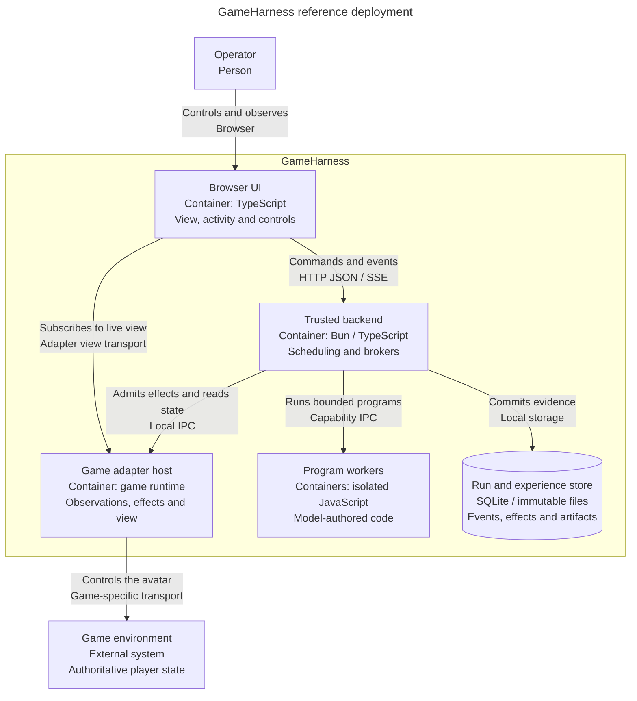

# Container view

This is the planned reference deployment. A C4 container is a separately running application, worker, or data store; it does not mean that every box runs in Docker. The local processes run on one supported Linux host, with model providers outside that deployment.

The GameHarness boundary contains the applications and data store owned by this project. This view focuses on local process and data ownership; the backend's remote provider and reference-retrieval relationships appear in the [system context](c4-context.md). OMP and other libraries are linked into the relevant applications, not deployed as separate services.

## Trust and ownership

The trusted backend owns model credentials, strategic conversations, policy registration, action admission, and persistence. The adapter host owns raw game-client state and the avatar connection. It returns only the observations and capabilities declared by its profile, rather than exporting its underlying client object.

Workers are untrusted. Every game effect crosses the checked broker and adapter interface. Workers cannot directly connect to the game, invoke providers, read the database or game saves, or use the live renderer's internal buffers as a data source. OS restrictions enforce isolation; IPC authorization and schema checks enforce the narrower application contract.

The browser is an operator surface, not a second authority for run state. Backend commands and adapter view subscriptions need authorization. In the reference deployment they bind to loopback. A renderer may possess data needed to draw an ordinary view; that data is not automatically permitted for generated programs.

SQLite stores run/registry metadata, ordered events, and the action ledger. Immutable files hold generated source and referenced artifacts. A game adapter declares whether environment saves, checkpoints, or resets are available. These remain separate from the runtime store and require reconciliation during recovery.

## First adapter mapping

The Minecraft adapter host uses Node.js 24, Mineflayer, and a first-person prismarine-viewer surface. Its environment is a Minecraft Java server. Minecraft-specific protocol details, block/entity visibility, mechanics, verification, and save handling stay in that adapter profile.

Another game can replace the adapter host implementation and game transport while retaining the backend, worker protocol, state/effect contracts, experience registry, and browser control surface. It supplies its own view transport and verifies compatibility instead of pretending that Minecraft's renderer or save format is universal.

The [runtime contracts](../runtime-contracts.md) define adapter conformance and effect admission. [Operations and security](../operations-and-security.md) defines isolation and recovery checks.
