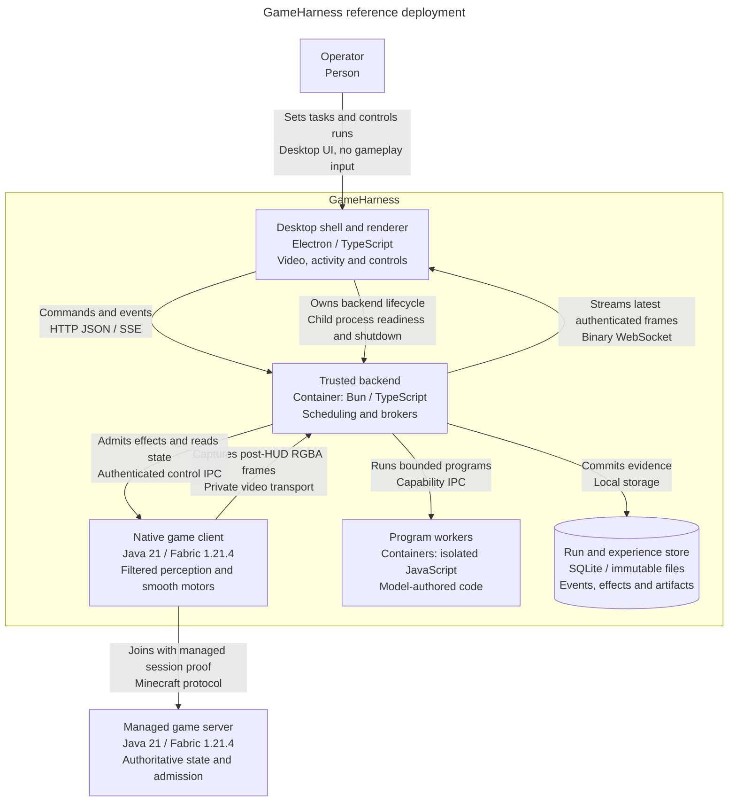

# Experimental GameHarness container view

This is the generic generated-program desktop/native deployment, separate from the primary [ordinary Java Survival player](../survival/play.md). A C4 container is a separately running application, worker or store, not necessarily a Docker container. Processes run on one Linux host; [scoped runtime evidence](../reference/evidence.md) records which paths have proof.

The GameHarness boundary contains the applications and data store owned by this experiment. This retained view summarizes local ownership, not every current process: cognition, readonly operator publication and derived-history writer are separate owned children of the trusted backend, detailed in the [architecture reference](../reference/architecture.md). Remote provider and reference-retrieval relationships appear in the [system context](c4-context.md). OMP and other libraries are linked into applications, not separate services.

## Trust and ownership

The trusted backend owns model credentials, strategic conversations, policy registration, action admission, and persistence. The adapter host owns raw game-client state and the avatar connection. It returns only the observations and capabilities declared by its profile, rather than exporting its underlying client object.

These are separate ownership lifetimes: a game session can span several agent runs and player lives. Pause, Stop run, goal closure and ordinary death retain a healthy native client/video; run fences await actual native neutralization and worker/planner/action drain. Only explicit model-selected vanilla respawn requests recovery; native replacement evidence establishes the new incarnation, with full gameplay readiness checked separately. Stop world, world replacement and desktop close end the owned session/processes; unconfirmable control failure remains fail-closed. This changes lifecycle ownership, not the deployment containers shown above.

Workers are untrusted. Every game effect crosses the checked broker and adapter interface. Workers cannot directly connect to the game, invoke providers, read the database or game saves, or use the live renderer's internal buffers as a data source. OS restrictions enforce isolation; IPC authorization and schema checks enforce the narrower application contract.

The sandboxed desktop renderer is an operator surface, not another run authority. Backend commands and video subscriptions require session and origin checks on loopback. The client suppresses physical gameplay/menu callbacks and polling. Human video access grants no frame/buffer capability to generated programs.

SQLite stores run/registry metadata, ordered events, and the action ledger. Immutable files hold generated source and referenced artifacts. A game adapter declares whether environment saves, checkpoints, or resets are available. These remain separate from the runtime store and require reconciliation during recovery.

## First adapter mapping

The Minecraft adapter uses the actual Fabric client and managed Java 21 server. Private session proof gates admission before a same-name client can displace the owned player. Control and post-HUD video are separate transports; observation filtering, mechanics, verification and save handling remain adapter responsibilities. Mineflayer/prismarine evidence belongs only to the retired spike, not an automatic fallback.

Another supported game must supply an adapter, view, mechanics, verifier and recovery evidence. The core carries a generic observation envelope with adapter-owned data and validates registered capability schemas against the negotiated descriptor. Minecraft supplies the current payload and mechanics; no second adapter or arbitrary trusted-plugin loading is delivered. The desktop shell, isolated program protocol and ownership rules are reusable boundaries, while rendering and saves remain game-specific.

The [adapter](../reference/adapters.md) and [action](../reference/actions.md) references define conformance and effect admission. [Security](../reference/security.md), [recovery](../reference/recovery.md) and [operations](../reference/operations.md) define the corresponding boundaries.
