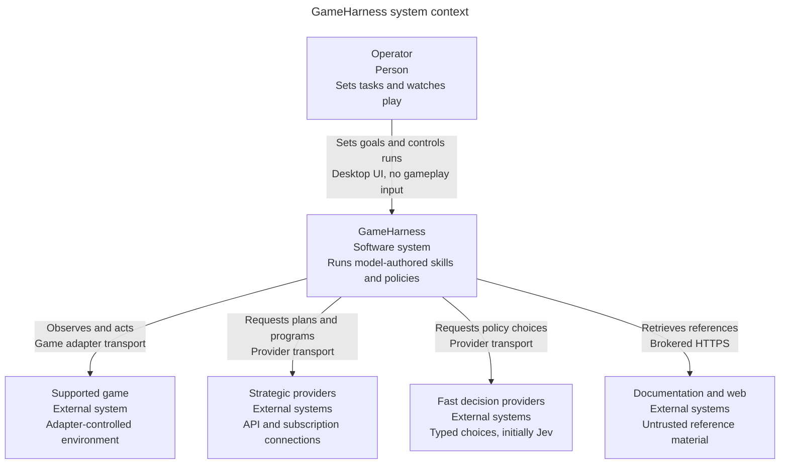

# System context

GameHarness connects strategic models, real fast-decision providers and game adapters through a standalone desktop. The repository contains implementation; this context view does not certify release readiness. See the [container view](c4-containers.md), [architecture](overview.md) and [integration evidence](../integration-spike.md).

The operator is a person. GameHarness is the system being built. The other boxes are external systems; their internals are outside this model.

A supported game needs an implemented adapter, observation profile, mechanics, authentic view, task verification and cancellation/recovery evidence. Extensibility is not automatic game support. Minecraft Java's actual Fabric client is the first integration.

One strategic agent controls one avatar in the initial runtime. A Jev-backed policy is a tool of that agent, while a local-code policy can make decisions without network inference. The core does not prescribe game-specific reactions for either backend.

The game session outlives individual tasks/runs and player lives. The operator can stop a run without closing a healthy game connection; ordinary death leaves the model responsible for an explicit vanilla respawn decision. Game/world shutdown remains a separate owned operation. These lifetimes introduce no additional external system or playing agent.

The live view and activity feed expose current behavior and actual outcomes. Model explanations do not replace game evidence. Documentation and web retrieval obey the same information restrictions as other tools; the [adapter observation contract](../runtime-contracts.md) prevents them from bypassing game permissions.
