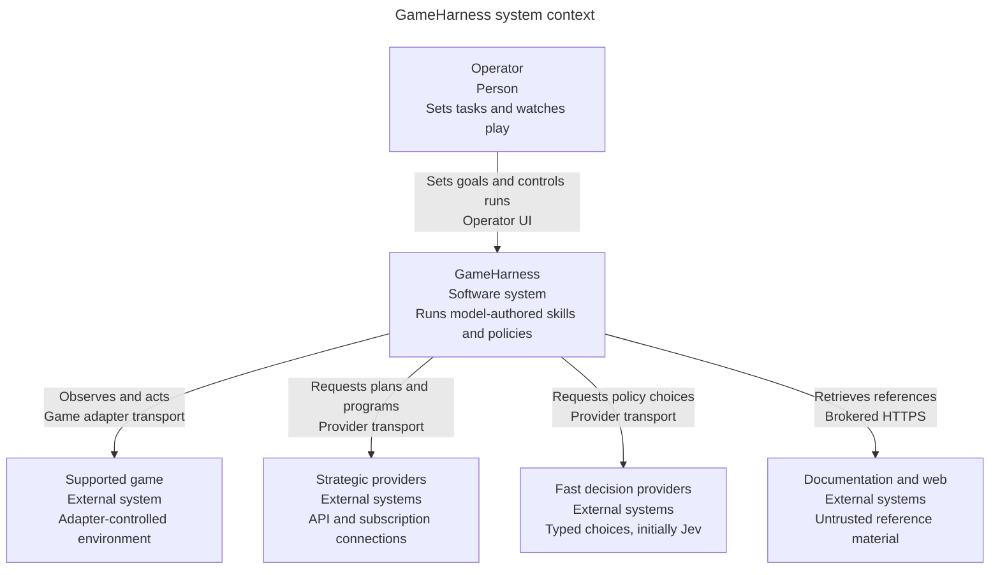

# System context

GameHarness connects strategic models, fast decision providers, and game-specific adapters. This is the planned product context, not a claim that any integration is already implemented. See the [container view](c4-containers.md) for process boundaries and the [architecture overview](overview.md) for design choices.

The operator is a person. GameHarness is the system being built. The other boxes are external systems; their internals are outside this model.

A supported game needs an implemented adapter, a declared observation profile, mechanic schemas, a live view, task verification, and evidence of its cancellation/recovery behavior. Extensibility does not mean that an arbitrary game works without integration. Minecraft Java is the first planned complete adapter.

One strategic agent controls one avatar in the initial runtime. A Jev-backed policy is a tool of that agent, while a local-code policy can make decisions without network inference. The core does not prescribe game-specific reactions for either backend.

The live view and activity feed expose current behavior and actual outcomes. Model explanations do not replace game evidence. Documentation and web retrieval obey the same information restrictions as other tools; the [adapter observation contract](../runtime-contracts.md) prevents them from bypassing game permissions.
