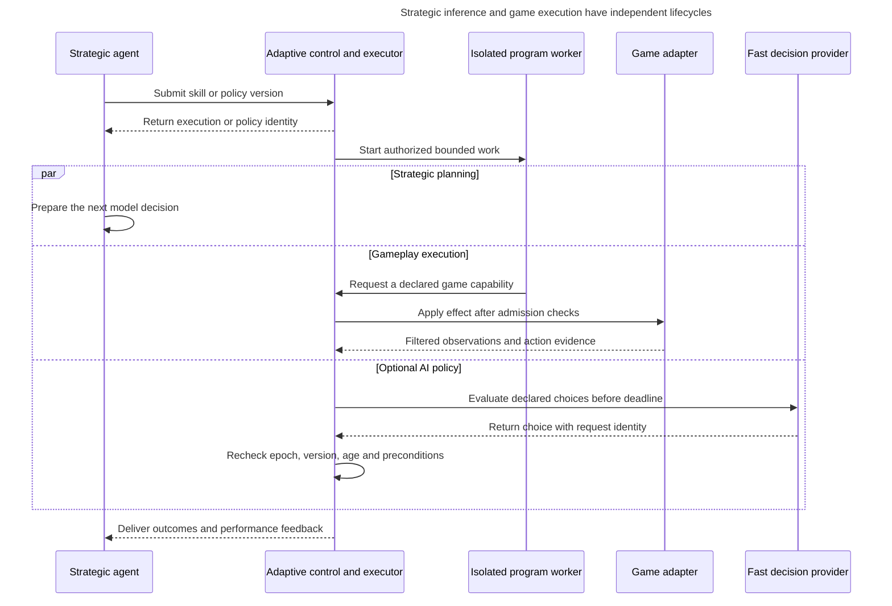

# Architecture overview

GameHarness is an extensible runtime for model-controlled games. A game adapter supplies observations, mechanics, a live view, task verification, and declared recovery capabilities. The core owns strategic model turns, generated programs, reactive policy execution, action arbitration, experience, and evidence.

This is an implementation specification. No application or game integration is implemented in this checkout. Minecraft Java is the first planned complete integration, not a permanent restriction on the product. Supporting another game requires an adapter and validation; it does not follow automatically from having a generic interface.

The [product requirements](../prds/gameharness-v1.0-prd.md) define intended behavior. The [context view](c4-context.md) and [container view](c4-containers.md) show the system at different levels. [Runtime contracts](../runtime-contracts.md) are authoritative for adapter interfaces, records, and lifecycle transitions.

## Core and adapter responsibilities

The core treats game observations and actions as adapter-declared schemas. It does not require blocks, enemies, recipes, health, a particular coordinate system, or a universal definition of winning. Those concepts belong to the selected game's observation profile and capability catalogue.

| Generic core responsibility | Adapter responsibility |
| --- | --- |
| Start and record an identifiable run with a task and selected experience snapshot | Connect or attach to the game and identify the environment lineage |
| Schedule strategic inference and policy evaluation | Produce permitted observations with provenance, timing, and schema identity |
| Admit, arbitrate, cancel, and fence effectful work | Validate game-specific action parameters/preconditions and implement mechanics |
| Enforce worker capabilities and a single effect owner | Acknowledge actual cancellation/neutralization, or report uncertainty honestly |
| Persist action evidence, programs, knowledge, and summaries | Verify game-defined task outcomes without leaking privileged information |
| Deliver run status and a truthful activity stream | Supply a live view and its freshness/availability information |
| Reconcile durable records after interruption | Declare and implement supported reconnect, reset, checkpoint, and restore operations |

The `GameAdapter` descriptor includes game, adapter, version, observation-profile, capability-schema, view-source, task-verifier, and recovery-support identities. Run manifests and reusable artifacts record the relevant identities, including the profile configuration fingerprint separately from its observation interface/schema. Incompatible permission/configuration changes invalidate cached validation and artifact applicability; they cannot silently relabel older evidence. A program written against one game's actions is not silently reusable in another game merely because both use JavaScript.

A game need not have a terminal victory state. Its tasks can instead define a verified objective such as reaching a location, producing an item, or completing a level. Optional save/reset/restore operations must advertise their actual support level. The core cannot promise a world rewind that the game does not provide.

## Process structure

A trusted backend owns the strategic conversation, scheduling, credentials, event journal, and policy registry. An adapter host owns the game's raw connection and data. Generated programs execute behind an operating-system isolation boundary and affect the game only through checked capability calls.

The initial deployment is a local Linux application with one playing avatar. Its backend is one application with internal modules, not a collection of independently deployed microservices. The adapter and generated-code workers are separate processes because they have different runtime and trust requirements.

| Area | Selected design | Reason and verification boundary |
| --- | --- | --- |
| Trusted backend | TypeScript on Bun 1.3.14 or later | Matches the inspected OMP packages. Public interfaces were exercised locally; a real game/provider loop remains unverified. |
| Strategic integration | Selected OMP `pi-ai` and `pi-agent-core` packages behind GameHarness-owned interfaces | Reuses provider and tool-calling behavior without adopting the full coding CLI. Exact initial package candidates are recorded in [upstream reuse](../upstream-reuse.md). |
| Fast decisions | `FastDecisionProvider`, initially backed by the OMP TypeSafe/Jev client | Supplies typed choices independently of strategic turns. Game-specific meaning remains in the model-authored policy. |
| Adapter host | A process implementing the declared `GameAdapter` contract | Keeps raw game access out of generated programs and permits game-specific runtimes. The first adapter uses Node.js 24 and Mineflayer. |
| Generated programs | JavaScript in OS-isolated worker processes/containers | Enforces restricted capability access independently of model instructions. |
| Browser UI | Small TypeScript application built with Vite | Displays the adapter-supplied view, activity, task/provider selection, and essential run controls. |
| Control and events | HTTP JSON commands and Server-Sent Events | Separates operator control from game/viewer-specific transports. |
| Durable state | SQLite with WAL, foreign keys, and durable transactions; immutable content-addressed artifact files | Gives one owner for run metadata, ordered events, action evidence, and experience. Game saves remain adapter-owned. |

These choices define an initial implementation, not a tested compatibility matrix. Runtime and package upgrades must be checked as a combination. No broader platform support follows from the diagram.

## Internal module ownership

A module's interface includes its ordering rules, cancellation behavior, failure modes, and resource limits as well as its methods.

| Module | Owns |
| --- | --- |
| Run coordinator | Lifecycle, configuration snapshots, bootstrap admission, pause/stop/recovery intent |
| Strategic agent | One serialized model conversation, declared tools, context compaction, model-authored plans and program proposals |
| Strategic Turn Scheduler | Durable wakeup cursors, coalesced reasons, bounded context batches, one strategic turn/request at a time, retry/backoff and explicit waiting |
| Autonomous Improvement Loop | Game-neutral evidence triggers, deduplicated opportunities, delivery/acknowledgement/deferral, one bounded improvement trial per run and outcome-driven wakeups |
| Adaptive control | Policy evaluation, fenced run-local version selection, trial enforcement and feedback delivery |
| Action executor | The avatar's foreground effect lease, priorities, cancellation acknowledgement, and final freshness checks |
| Game adapter | Game-specific observation permissions, capability schemas, mechanics, view, and result verification |
| Program broker and workers | Isolated execution and validated capability requests with explicit serializable state |
| Experience registry | Selective metadata/source/evidence reads, idempotent knowledge/promotion mutations, immutable per-model snapshots and model-authored startup bundles |
| Evidence and evaluation | Durable outcomes, timing, task-verifier results, and intervention records |
| Credential/provider integration | Supported API/subscription flows, refresh, provider requests, and redacted connection status |
| Browser delivery | A projection of authoritative run state and the adapter's current live view |

Infrastructure supplies mechanisms rather than game tactics. A model decides what to acquire, where to go, what to automate, and which policy backend to use. Generic execution code must not hide a developer-written strategy behind an otherwise generic tool name.

## Independent execution rates

Strategic inference, action execution, and policy evaluation proceed independently. A model request must not hold the avatar's action lease while waiting for a provider. Authorized work can continue, and compatible policies can evaluate newer observations in parallel.

Local code and Jev are different execution mechanisms. A JavaScript policy can react without a network request; a Jev policy asks a remote model to choose from declared alternatives before a deadline. Neither is guaranteed to meet a particular response time simply because it is called reactive.

One OMP `Agent` instance still has serialized strategic turns. Its tool-batch concurrency is not the game scheduler. GameHarness tools submit long-running work promptly and expose status/results separately.

The internal [Strategic Turn Scheduler](../runtime-contracts.md#strategic-turn-scheduler) starts the next turn without an operator prompt: bootstrap, attributed task changes, action/skill outcomes requiring a decision, policy replans, recovery completion, no runnable work, and due improvement/trial feedback provide durable wake signals. An existing skill/queue can take its next permitted step without another model call. Coalescing, bounded event batches, consumed cursors and finite backoff prevent observation polling and completion bursts from becoming prompt storms. Signals arriving during inference join the next boundary; pause, stop, task changes and recovery fence obsolete output.

Only the executor admits effects. Read-only observation and inference can overlap; competing programs cannot independently write different control channels and evade the foreground lease. An adapter may expose a bounded composite mechanical action that coordinates several inputs under that one owner.

## Bootstrap and adaptation

Both cold and warm runs receive the same capability catalogue and game-independent explanation of inference latency and policy-authoring tools. Warm runs additionally receive a selected compatible immutable experience snapshot. Cold does not mean disabled programming, reference access, or fast-model support.

Bootstrap uses the [runtime's configurable calibration defaults](../runtime-contracts.md#autonomous-improvement-loop), not a universal adequacy claim. Per-model settings are frozen equally across matched arms. Preparation, actual calls/attempts, retrieval, validation/cache, activation and first confirmed effect are measured; failures cannot restart the allowance. If no eligible version is selected before expiry, gameplay starts visibly without a policy; the runtime does not insert a hidden tactic.

A warm snapshot can carry a model-authored startup bundle selecting exact compatible policy/card versions for declared tasks/profiles. The host checks source, security, provenance, applicability and validation-cache identities, then rehydrates fresh run-local state and uses ordinary fenced activation. Eligible inherited selections need no source regeneration or repeated tactical trial and can activate with zero strategic authoring calls. No effects occur until current observations/preconditions and the normal action gate permit them. Missing/rejected entries are visible and use normal bootstrap with the remaining allowance. Unselected programs stay behind selective retrieval, not wholesale in model context.

The model creates local code or a typed AI configuration using the selected adapter's observation/action schemas. The host checks capabilities, output shape, isolation, and bounded execution. Real bounded trials provide behavioral evidence; schema validity alone cannot prove that a policy is effective.

The [Autonomous Improvement Loop](../runtime-contracts.md#autonomous-improvement-loop) proactively recognizes repeated inference gaps, capability/error or interruption patterns, repeated short capability sequences, evidence-bearing task/skill boundaries and due trials. It merges duplicate evidence and offers bounded opportunities at the next eligible strategic turn without pausing gameplay. The model must retrieve/reuse, author/revise with a hypothesis and bounded trial, keep/retire/revert with evidence, or explicitly defer/reject. Durable acknowledgement and deferral survive restart; the runtime reports facts and enforces bounds, while the same strategic model chooses gameplay changes.

`experience.search` returns bounded compatible metadata/StrategyCard/performance summaries; `experience.get` fetches exact source/card/evidence only when needed. `experience.getPerformanceHistory` preserves failures, unknowns and context. Idempotent `experience.saveKnowledge` and `experience.proposePromotion` retain durable outcomes across lost acknowledgements. The trusted evidence gate can accept eligible proposals without human approval, creating a new snapshot for future runs; sealed comparisons defer publication. Reads stay within the selected snapshot and current run-private branch. The [runtime interface](../runtime-contracts.md#selective-experience-interface) defines exact fields; the [learning protocol](../learning-and-evaluation.md#selective-retrieval-and-autonomous-promotion) defines portability and promotion evidence.

Revisions create immutable source/card artifacts. Activation replaces a selected version at a scheduling boundary, and callbacks from revoked generations cannot issue new effects. Selection pointers, trial counters, evaluation generations and private state belong to `(run_id, policy_id)`, never to a shared inherited snapshot. A trial bound fences new proposals, restores its declared prior selection or no policy, and wakes the strategist to assess outcomes. Restoring an earlier policy changes future control; it does not restore the game's state. Useful current-run behavior requires real evidence, and before/after timing alone is not a causal result.

## Observation permissions

Every adapter defines an information-permission profile separately from its observation interface. Structured state/events and future images describe delivery, not fairness by themselves. The profile distinguishes current observation, remembered evidence, unknown state and any declared controller-only information. Agent-facing permissions apply to tools, action errors, generated programs, retrieved content and reusable memory; private controller permissions do not widen those APIs.

A raw game client can possess data that the agent may not observe. The trusted adapter must filter it before it reaches the strategist or workers, including counts, ordering, pagination/truncation metadata, logs and errors. Agent searches use the authorized observation index, not raw discovery functions with a filtered prompt. Giving the model an unfiltered client object through generated code would violate the interface.

The human live view is a separate capability. Its renderer buffers and endpoints are not a shortcut around the agent's observation profile. Privileged task verification may inspect authoritative game state where necessary, but the verifier's hidden inputs must remain separate from the agent-visible result and control path.

### Minecraft reference profile

The first complete integration targets Minecraft Java 1.21.4 in Normal Survival. Its trusted Node.js 24 host owns Mineflayer and serves a first-person prismarine-viewer view. A compatible Java 21 runtime is the initial server target. This combination has not yet been exercised as a game integration.

The required initial permission profile is [`player-observable-structured`, version 1](../runtime-contracts.md#player-observable-structured-profile-v1). Its canonical settings and finite bounds live in the runtime contract. Nearby unobstructed objects/entities are eligible regardless of camera yaw/pitch; an unobstructed tree behind the camera is observable. Range and obstruction still apply. Own inventory/status/UI, normal F3 position, public recipes/docs and legitimate world-local memory are allowed. Unobserved remains unknown. Hidden ore/resources, undiscovered structures, exact live state of occluded entities, seed, saves and raw chunks/entity enumeration remain protected.

Remembered entities retain their last-authorized position/time and uncertainty, not hidden live tracking. Actual audible game events may expose only the profile's coarse sound categories/direction/distance, never synthesized hearing from raw entities or precise hidden source coordinates/handles. This structured profile is an explicit information approximation, not a claim of human-identical perception or formal zero leakage. A strict camera-based profile is optional future work, not a prerequisite for the first playable slice.

Mechanical capabilities include bounded movement/look/input and explicitly chosen interaction, digging, placing, crafting, equipment changes and navigation. The [bounded private navigation exception](../runtime-contracts.md#bounded-private-navigation-geometry) permits trusted local collision/passability/headroom reads from client-loaded terrain while moving toward authorized known goals/waypoints. Local avoidance and detours inside the execution envelope toward the same goal may use previously unseen cells; every collision voxel need not have been individually observed. That geometry stays separate from the agent's object/memory index and carries no hidden resource/entity/material identity. Additional material/hazard semantics require authorized observation. Admission rejects hidden-target probes before lookup, local read/planning limits constrain helpers such as A*, and actual outputs/errors cannot reveal private maps or raw paths. Neither local helpers nor a global loaded-world planner may use hidden geometry to discover/select a cave, entrance, corridor, shortcut or exploration route as a higher-level route; such a dependency requires further observation/replanning or a neutral bounded-execution failure. Gathering, combat, survival and exploration strategies remain model-authored. Internal reads and actual effects require conformance evidence, not merely a filtered route.

Paper Anti-Xray is optional defense in depth, not required or sufficient filtering; the adapter must enforce the profile with it disabled. The runtime contract requires recorded server flavor/build and effective per-world/dimension configuration, frozen across matched comparisons. [Verified upstream evidence](../upstream-reuse.md#structured-observation-and-navigation-evidence) describes Mineflayer and Paper limits; a block-occlusion helper alone is not proof of this profile's permissions.

The reference view must be checked for real motion, interaction fidelity, and freshness. A documented `firstPerson` flag is not evidence that the complete product has an adequate live view. Minecraft world saves and backups remain separate from the runtime's journal and follow the adapter-specific operating procedure.

## Isolation and provider access

Workers receive immutable program source, an explicit capability set, bounded inputs, and declared serializable state. They do not receive provider credentials, the database connection, raw game-client objects, game save paths, or the host home directory.

OS isolation enforces filesystem, network, process, and resource restrictions. The trusted broker checks each request again, including adapter capability, active run/epoch, action ownership, and permissions. Ordinary OMP eval, Node `vm`, and a Worker alone are not this security boundary.

Documentation and internet access use a trusted retrieval broker. Its output is untrusted content; it cannot grant capabilities, reach private host services, inspect renderer state, or obtain hidden game information. Provider requests use supported authentication flows in the trusted backend. A subscription, a valid token, and permission to invoke a particular model are distinct conditions.

Usage reporting preserves provider attempts, available counters, pricing provenance, and unknown costs. An all-zero placeholder price is not evidence of free inference. Finite retries, concurrency limits, deadlines, and host stop protect execution correctness and availability independently of usage accounting.

Jev can be disabled for a code-only run. Failure in a Jev-enabled run is recorded and exposed; a replacement provider or local result must not silently be labelled a successful Jev response. Details are in [upstream reuse](../upstream-reuse.md) and [operations and security](../operations-and-security.md).

## Persistence and recovery

The strategic journal, action ledger, experience registry, and game environment have different owners. Conversation summaries cannot prove that an external effect completed before a crash. Generated closures and pending promises are not durable continuations.

Recovery fences old emitters, reconnects through the adapter, advances the execution epoch, obtains current permitted observations, and reconciles unresolved work before admitting more effects. A stable action identifier deduplicates submissions but does not guarantee exactly-once game effects. An uncertain outcome can remain explicitly `unknown` while the run safely continues.

Checkpoint/reset/restore support is adapter-specific. When restoration is available, record its effect on environment lineage and reconcile memory with the restored state. When it is unavailable, report that limitation rather than implying that restoring a conversation restores the game. Recovery must preserve downtime and intervention evidence.

Cross-session reuse is different from resuming the same environment. A transferable program can move to a compatible new run; facts about an earlier world, map, level state, or inventory cannot become facts about a new one without fresh evidence.

## Operator surface

The browser sends authorized commands and subscribes to events with durable identities. Its activity feed reflects backend state rather than independently deciding that a task succeeded. Viewer freshness and disconnects are visible conditions.

The activity surface also shows an improvement card with the actual skill/policy version change, why it changed, semantic changes, and measured trial outcome or “not yet measured.” Authorized read routes expand the exact [StrategyCard](../learning-and-evaluation.md#human-readable-strategy-artifacts), source and evidence events without exposing another run's data, secrets or hidden evaluator inputs. The UI may display authorized generated source code as escaped, non-executable text. Viewing source grants no execution/capability authority and cannot install or activate a policy; model-authored markup/scripts must not execute in the operator origin. Proposal, effective activation and reverted/no-effect outcomes remain distinct. This requires neither a full library browser nor an editor/replay interface.

Pause and stop follow the adapter's declared effect-neutralization and connection behavior. They must not silently freeze a game to conceal model inference latency. In the Minecraft profile, pause leaves the avatar connected with neutral controls while the world continues; survival is not guaranteed. Operator pauses are recorded separately from ordinary waits.

The default deployment binds control and view surfaces to loopback with origin and command authorization. Public hosting requires a separate deployment/security design; it is not implied by an external-user-friendly local interface.

## Adding another game

A new integration supplies an adapter descriptor, observation profile, mechanic schemas and implementations, view source, task verifiers, and explicit cancellation/recovery support. It also supplies compatibility metadata and evidence that these contracts are enforced.

The generic coordinator, policy registry, worker protocol, action lease, provider integration, and event semantics should not need game-specific branches. New state fields are interpreted through the adapter schema. New game tactics remain model-authored code/configuration rather than additions to the scheduler.

Follow the [adapter contract and conformance requirements](../runtime-contracts.md). Validate a real end-to-end task, observation permissions, cancellation/stale-result behavior, and declared recovery limits before describing the game as supported. A descriptor alone is not a working integration.

This extension seam does not require a plugin marketplace, arbitrary hot-loading into the trusted backend, a distributed service layer, or an implemented second game in order to complete the first integration.
