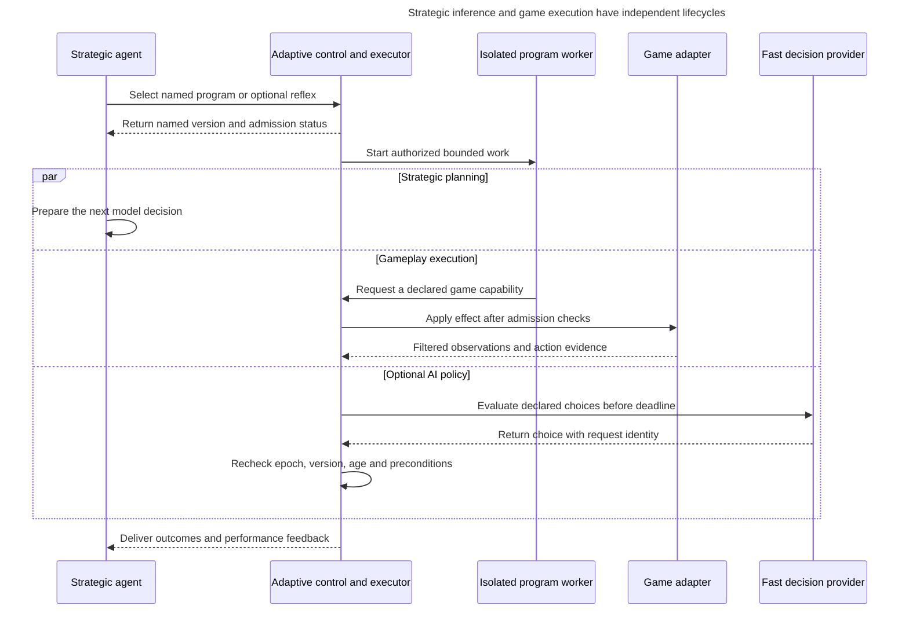

# Architecture overview

GameHarness is an extensible runtime for model-controlled games. A game adapter supplies observations, mechanics, a live view, task verification, and declared recovery capabilities. The core owns strategic model turns, generated programs, reactive policy execution, action arbitration, experience, and evidence.

This document describes the desktop/native/program implementation direction and the broader release contracts. The repository contains implementation, but the [integration guide](../integration-spike.md) distinguishes old-spike results from current native proof. Minecraft Java is the first integration, not a permanent restriction on the product. Supporting another game requires an adapter and validation.

The [product requirements](../prds/gameharness-v1.0-prd.md) define intended behavior. The [context view](c4-context.md) and [container view](c4-containers.md) show the system at different levels. [Runtime contracts](../runtime-contracts.md) are authoritative for adapter interfaces, records, and lifecycle transitions.

## Core and adapter responsibilities

The extension contract requires adapter-declared observations/actions rather than universal blocks, enemies, recipes, health, coordinates or victory conditions. Those concepts belong to a game's profile and capabilities. The current shared `Observation` and `GameAction` types still implement the first Minecraft profile; arbitrary schema negotiation and a second game adapter are not implemented. Generalizing those concrete types is implementation work for additional supported games, not behavior already supplied by the descriptor below.

| Generic core responsibility | Adapter responsibility |
| --- | --- |
| Start and record an identifiable run with a task and selected experience snapshot | Connect or attach to the game and identify the environment lineage |
| Schedule strategic inference and policy evaluation | Produce permitted observations with provenance, timing, and schema identity |
| Admit, arbitrate, cancel, and fence effectful work | Validate game-specific action parameters/preconditions and implement mechanics |
| Enforce worker capabilities and a single effect owner | Acknowledge actual cancellation/neutralization, or report uncertainty honestly |
| Persist action evidence, programs, knowledge, and summaries | Verify game-defined task outcomes without leaking privileged information |
| Deliver run status and a truthful activity stream | Supply a live view and its freshness/availability information |
| Reconcile durable records after interruption | Declare and implement supported reconnect, reset, checkpoint, and restore operations |

The normative `GameAdapter` descriptor requires game, adapter, profile, capability-schema, view-source, verifier and recovery-support identities. It is the extension target, not an implemented arbitrary-schema plugin protocol. Manifests/artifacts must retain applicable compatibility identities and configuration fingerprints; permission changes cannot relabel old validation or evidence. Sharing JavaScript does not make programs portable between games.

A game need not have a terminal victory state. Its tasks can instead define a verified objective such as reaching a location, producing an item, or completing a level. Optional save/reset/restore operations must advertise their actual support level. The core cannot promise a world rewind that the game does not provide.

## Process structure

A trusted backend owns the strategic conversation, scheduling, credentials, event journal, and policy registry. An adapter host owns the game's raw connection and data. Generated programs execute behind an operating-system isolation boundary and affect the game only through checked capability calls.

The initial deployment is a local Linux application with one playing avatar. Its backend is one application with internal modules, not a collection of independently deployed microservices. The adapter and generated-code workers are separate processes because they have different runtime and trust requirements.

| Area | Selected design | Reason and verification boundary |
| --- | --- | --- |
| Trusted backend | TypeScript on Bun 1.3.14 or later | Owns authorization and durable evidence; old-spike provider results do not certify the new native loop. |
| Strategic integration | Selected OMP `pi-ai` and `pi-agent-core` packages behind GameHarness-owned interfaces | Reuses provider and tool-calling behavior without adopting the full coding CLI. Exact initial package candidates are recorded in [upstream reuse](../upstream-reuse.md). |
| Fast decisions | `FastDecisionProvider`, initially backed by the OMP TypeSafe/Jev client | Supplies typed choices independently of strategic turns. Game-specific meaning remains in the model-authored policy. |
| Adapter host | Actual Java 21 / Fabric 1.21.4 Minecraft client with trusted Bun bridge | Owns filtered native perception and bounded smooth motors; no Mineflayer compatibility path or automatic fallback. |
| Generated programs | JavaScript in OS-isolated worker processes/containers | Enforces restricted capability access independently of model instructions. |
| Desktop UI | Electron-owned window with Vite-built TypeScript renderer | Displays authentic native frames, compact controls and a hideable sidebar; setup/source/cards/history use dialogs. |
| Control and events | Authenticated HTTP JSON/SSE and native control IPC | Keeps run control separate from the authenticated binary `/v1/video` WebSocket. |
| Durable state | SQLite with WAL, foreign keys, and durable transactions; immutable content-addressed artifact files | Gives one owner for run metadata, ordered events, action evidence, and experience. Game saves remain adapter-owned. |

These choices define an initial implementation, not a tested compatibility matrix. Runtime and package upgrades must be checked as a combination. No broader platform support follows from the diagram.

## Internal module ownership

A module's interface includes its ordering rules, cancellation behavior, failure modes, and resource limits as well as its methods.

GameHarness must be language-agnostic at component boundaries. Performance-critical components may be implemented in native languages without modifying the agent runtime, skill format, or game adapter contracts. Bounded serializable messages, versioned schemas, ownership and cancellation semantics define those boundaries, not TypeScript object identity. Keep orchestration/providers/memory/evaluation in TypeScript, actual Fabric observation/motor/capture in Java, and generated skills in JavaScript. Consider Rust only after a measured bottleneck justifies it; do not add a speculative service.

Decompose the runtime by responsibility: lifecycle/coordinator, strategic scheduling/context, program execution, policy arbitration, provider accounting, experience and evidence. Extract real owners rather than retaining a monolithic runtime behind forwarding wrappers. CPU, event-loop delay, observation/command latency, delivered FPS and program duration identify where optimization belongs; language changes do not establish token savings.

| Module | Owns |
| --- | --- |
| Run coordinator — `runtime.ts` | Lifecycle and trusted observation/goal authority, configuration, pause/stop/recovery intent |
| Speculative planning — `speculative-planning.ts` | One-flight preparation, pinned predecessor/source closure, optional isolated game guard and one-use Main-authorized continuation |
| Strategic planner — `strategic.ts` | Authenticated Agent, serialized turns/wakes, compact context, one-shot attention, actual request purpose and usage |
| Runtime tools — `runtime-tools.ts` | Shared role/module registry enforcement, schema dispatch and trusted tool-call retry identity |
| Program workspace — `program-operations.ts`, `program-workspace.ts` | Named immutable authoring/execution/review, pinned selection and bounded evidence; schemas/help live in `program-interface.ts`/`program-help.ts` |
| Autonomous Improvement Loop | Game-neutral evidence triggers, deduplicated opportunities, delivery/acknowledgement/deferral, one bounded improvement trial per run and outcome-driven wakeups |
| Reactive runtime — `reactive.ts` | Policy registry/selection, trials, workers, evaluation, real Jev and fenced preemption |
| Action arbiter — `action-arbiter.ts` | Durable admission/deduplication, priority queue, exclusive leaf-effect lease, cancellation and emitter draining |
| Game adapter | Game-specific observation permissions, capability schemas, mechanics, view, and result verification |
| Skill manager — `skills.ts` | Durable program trees, shared budgets and checked capability broker; sandbox execution remains separate |
| Experience library — `experience.ts` | Explicit model-scoped snapshots, useful-gameplay predicate gates, portability/world-local declarations and fresh exact-version hydration |
| Program evidence — `program-evidence.ts` | Attributable execution/action outcomes and measured effectiveness, kept separate from compactness |
| Trace, improvement and comparison | Bounded authorized execution evidence, durable opportunities, exact revision links and descriptive objective samples; DTOs in `src/shared/execution-evidence.ts` |
| Credential/provider integration | Supported API/subscription flows, refresh, provider requests, and redacted connection status |
| Desktop delivery | Owned backend lifecycle and a read-only projection of authoritative state and native video |

These implementation modules live under `src/server/`; the public `Runtime` lifecycle API remains the composition boundary. Broader knowledge/search/history and autonomous-improvement requirements still need their own delivery evidence; the module split does not establish those gates. TypeScript contains no per-tick gameplay motor or speculative Rust service.

The adapter owns a game session (`session_id`, `world_id`, connection `epoch`); the coordinator owns individual agent runs; native authoritative readiness owns player lives. Run completion, Pause and Stop revoke and drain run emitters through `GameBridge.neutralize()` without disconnecting a healthy session. Ordinary death fences old-life work and targets, preserves real DeathScreen video and an active run, and wakes one strategic decision. Only an explicit model-selected `game.respawn()` through the ordinary arbiter requests vanilla respawn. Confirmed new-life readiness advances life ID while preserving session/epoch; saved-dead startup never respawns automatically. Explicit Stop world, world replacement and desktop close own session/process teardown. Genuine unconfirmable control loss still fails closed.

Infrastructure supplies mechanisms rather than game tactics. A model decides what to acquire, where to go, what to automate, and which policy backend to use. Generic execution code must not hide a developer-written strategy behind an otherwise generic tool name.

## Independent execution rates

Strategic inference, action execution, and policy evaluation proceed independently. A model request must not hold the avatar's action lease while waiting for a provider. Authorized work can continue, and compatible policies can evaluate newer observations in parallel.

Compact model-authored asynchronous programs are the main gameplay unit. Exact-version composition shares one root deadline and action/call/depth budgets. Parents do not own the avatar lease; only a leaf action does. Static parsing, canonical formatting and complexity limits govern source admission, while separate Docker controls isolate execution. Host-known capability waits can suspend the runnable CPU deadline; worker heartbeats cannot extend authority.

Local code and Jev are different execution mechanisms. A JavaScript policy can react without a network request; a Jev policy asks a remote model to choose from declared alternatives before a deadline. Neither is guaranteed to meet a particular response time simply because it is called reactive.

One OMP `Agent` instance still has serialized strategic turns. Its tool-batch concurrency is not the game scheduler. GameHarness tools submit long-running work promptly and expose status/results separately.

The [Strategic Turn Scheduler](../runtime-contracts.md#strategic-turn-scheduler) wakes on bootstrap, root-program closure or other meaningful decision outcomes, policy replan, recovery, genuinely absent runnable work and due feedback. Leaf results inside a pending program return to its authored task flow, not a strategic prompt. One-shot attention remains explicit and bounded. Direct strategic action-submit/cancel tools and aliases are removed; programs/reactions alone own new effects through the arbiter. Coalescing and finite context/backoff prevent polling storms; lifecycle/task changes fence obsolete output.

Only the executor admits effects. Read-only observation and inference can overlap; competing programs cannot independently write different control channels and evade the foreground lease. An adapter may expose a bounded composite mechanical action that coordinates several inputs under that one owner.

## Bootstrap and adaptation

Both cold and warm runs receive the same capability catalogue and game-independent explanation of inference latency and policy-authoring tools. Warm runs additionally receive a selected compatible immutable experience snapshot. Cold does not mean disabled programming, reference access, or fast-model support.

Host preflight checks readiness and fresh authoritative state before ordinary scheduling; it does not require several model calls to confirm those facts. Per-model bounds are frozen equally across matched arms. Preparation, actual requests/exposed attempts, retrieval, validation/cache, activation and first confirmed effect are measured; failures cannot reset an allowance. An absent reaction remains explicit and inserts no hidden tactic.

The broader release startup-bundle contract selects exact compatible model-authored policies/cards for declared tasks/profiles; it is distinct from the current named program snapshot load. The host checks source, security, provenance, applicability and validation-cache identities, rehydrates fresh state and uses ordinary fenced activation. Eligible selections need no source regeneration or repeated tactical trial and can need zero strategic authoring calls. Effects still require fresh state and the ordinary gate. Missing/rejected entries remain visible; ordinary authoring can choose alternatives within remaining limits. Unselected programs stay behind selective retrieval.

The model creates local code or a typed AI configuration using the selected adapter's observation/action schemas. The host checks capabilities, output shape, isolation, and bounded execution. Real bounded trials provide behavioral evidence; schema validity alone cannot prove that a policy is effective.

The [Autonomous Improvement Loop](../runtime-contracts.md#autonomous-improvement-loop) proactively recognizes repeated inference gaps, capability/error or interruption patterns, repeated short capability sequences, evidence-bearing task/skill boundaries and due trials. It merges duplicate evidence and offers bounded opportunities at the next eligible strategic turn without pausing gameplay. The model must retrieve/reuse, author/revise with a hypothesis and bounded trial, keep/retire/revert with evidence, or explicitly defer/reject. Durable acknowledgement and deferral survive restart; the runtime reports facts and enforces bounds, while the same strategic model chooses gameplay changes.

`experience.search` returns bounded compatible metadata/StrategyCard/performance summaries; `experience.get` fetches exact source/card/evidence only when needed. `experience.getPerformanceHistory` preserves failures, unknowns and context. Idempotent `experience.saveKnowledge` and `experience.proposePromotion` retain durable outcomes across lost acknowledgements. The trusted evidence gate can accept eligible proposals without human approval, creating a new snapshot for future runs; sealed comparisons defer publication. Reads stay within the selected snapshot and current run-private branch. The [runtime interface](../runtime-contracts.md#selective-experience-interface) defines exact fields; the [learning protocol](../learning-and-evaluation.md#selective-retrieval-and-autonomous-promotion) defines portability and promotion evidence.

Revisions create immutable source/card artifacts. Activation replaces a selected version at a scheduling boundary, and callbacks from revoked generations cannot issue new effects. Selection pointers, trial counters, evaluation generations and private state belong to `(run_id, policy_id)`, never to a shared inherited snapshot. A trial bound fences new proposals, restores its declared prior selection or no policy, and wakes the strategist to assess outcomes. Restoring an earlier policy changes future control; it does not restore the game's state. Useful current-run behavior requires real evidence, and before/after timing alone is not a causal result.

Delivered death/failure/outcome opportunities, exact model-authored revisions and objective comparison are narrower than the broader release detector catalogue above. Trace records actual API requests/results, authorized snapshots, instrumented branches, intent and categorized spans with explicit byte/record omissions; it exposes no chain of thought or inferred reason for target selection. Same-session/model `working_candidate` definitions can persist across tasks without old args/state/observations, separately from evidence-qualified cross-session snapshots.

Optional preparation stages no effects. Main can authorize a single successor at root start for manual activation or on successful predecessor closure. The restricted planner only selects/stages an existing program; the host owns the permit, full scope checks, drain and fresh ordinary admission. A model game guard is optional and receives only fresh observation/args, not task/control metadata; omission does not bypass host invariants. Either arrival order of staging and predecessor drain is supported by the host task, without another activation inference. The [continuation contract](../runtime-contracts.md#bounded-speculative-planning) links scoped native evidence separately from model/gameplay acceptance.

After verified goal, bounded `reviewing` is effect-free: candidates may be authored, but no extra gameplay trial occurs.

## Observation permissions

Every adapter defines an information-permission profile separately from its observation interface. Structured state/events and future images describe delivery, not fairness by themselves. The profile distinguishes current observation, remembered evidence, unknown state and any declared controller-only information. Agent-facing permissions apply to tools, action errors, generated programs, retrieved content and reusable memory; private controller permissions do not widen those APIs.

A raw game client can possess data that the agent may not observe. The trusted adapter must filter it before it reaches the strategist or workers, including counts, ordering, pagination/truncation metadata, logs and errors. Agent searches use the authorized observation index, not raw discovery functions with a filtered prompt. Giving the model an unfiltered client object through generated code would violate the interface.

The human live view is a separate capability. Its renderer buffers and endpoints are not a shortcut around the agent's observation profile. Privileged task verification may inspect authoritative game state where necessary, but the verifier's hidden inputs must remain separate from the agent-visible result and control path.

### Minecraft reference profile

The first complete integration uses a managed Minecraft Java 1.21.4 Normal Survival server and an actual Fabric client under Java 21. The server admits only the managed session through authenticated admission, not merely a matching name or player cap. The client suppresses ordinary physical gameplay/menu callbacks and polling; the human operates only GameHarness controls. A smooth bounded motor supplies shortest-angle aiming, held movement and permitted composite interaction under one owner.

The required initial permission profile is [`player-observable-structured`, version 1](../runtime-contracts.md#player-observable-structured-profile-v1). Its canonical settings and finite bounds live in the runtime contract. Nearby unobstructed objects/entities are eligible regardless of camera yaw/pitch; an unobstructed tree behind the camera is observable. Range and obstruction still apply. Own inventory/status/UI, normal F3 position, public recipes/docs and legitimate world-local memory are allowed. Unobserved remains unknown. Hidden ore/resources, undiscovered structures, exact live state of occluded entities, seed, saves and raw chunks/entity enumeration remain protected.

Remembered entities retain their last-authorized position/time and uncertainty, not hidden live tracking. Actual audible game events may expose only the profile's coarse sound categories/direction/distance, never synthesized hearing from raw entities or precise hidden source coordinates/handles. This structured profile is an explicit information approximation, not a claim of human-identical perception or formal zero leakage. A strict camera-based profile is optional future work, not a prerequisite for the first playable slice.

Mechanical capabilities include bounded movement/look/input and explicitly chosen interaction, digging, placing, crafting, equipment changes and navigation. The [bounded private navigation exception](../runtime-contracts.md#bounded-private-navigation-geometry) permits trusted local collision/passability/headroom reads from client-loaded terrain while moving toward authorized known goals/waypoints. Local avoidance and detours inside the execution envelope toward the same goal may use previously unseen cells; every collision voxel need not have been individually observed. That geometry stays separate from the agent's object/memory index and carries no hidden resource/entity/material identity. Additional material/hazard semantics require authorized observation. Admission rejects hidden-target probes before lookup, local read/planning limits constrain helpers such as A*, and actual outputs/errors cannot reveal private maps or raw paths. Neither local helpers nor a global loaded-world planner may use hidden geometry to discover/select a cave, entrance, corridor, shortcut or exploration route as a higher-level route; such a dependency requires further observation/replanning or a neutral bounded-execution failure. Gathering, combat, survival and exploration strategies remain model-authored. Internal reads and actual effects require conformance evidence, not merely a filtered route.

Paper Anti-Xray is optional defense in depth, not required or sufficient filtering; the adapter must enforce the profile with it disabled. The runtime contract requires recorded server flavor/build and effective per-world/dimension configuration, frozen across matched comparisons. [Verified upstream evidence](../upstream-reuse.md#structured-observation-and-navigation-evidence) describes Mineflayer and Paper limits; a block-occlusion helper alone is not proof of this profile's permissions.

The client captures its final framebuffer after world, hand and HUD rendering. Bounded latest-frame transport is independent of control; stale/error video cannot be replaced with synthetic footage. Hidden/unfocused rendering, resize, input suppression and capture-to-draw latency need actual evidence. Minecraft world saves and backups remain separate from the runtime journal.

Observation schema 2/preset r2 retain the same camera-independent structured line-of-sight permissions while adding session/life and optional eligible ItemEntity registry `item_name`; exact dropped-stack counts and NBT remain hidden. Live operator motor profiles (`precise`, default `balanced`, `fast`) are persisted mechanical configuration. Navigation gaze follows sampled actual local route geometry or an explicit target/free orientation, with yaw-based movement gating and legal strafe synthesis. `look` and `move.look` remain available. `break_log` verifies removal; `collect_wood` verifies receipted own-inventory gain, preserving its run baseline across death.

## Isolation and provider access

Workers receive immutable program source, an explicit capability set, bounded inputs, and declared serializable state. They do not receive provider credentials, the database connection, raw game-client objects, game save paths, or the host home directory.

OS isolation enforces filesystem, network, process, and resource restrictions. The trusted broker checks each request again, including adapter capability, active run/epoch, action ownership, and permissions. Ordinary OMP eval, Node `vm`, and a Worker alone are not this security boundary.

Documentation and internet access use a trusted retrieval broker. Its output is untrusted content; it cannot grant capabilities, reach private host services, inspect renderer state, or obtain hidden game information. Provider requests use supported authentication flows in the trusted backend. A subscription, a valid token, and permission to invoke a particular model are distinct conditions.

Usage reporting preserves host admissions, available provider counters, pricing provenance and unknown costs/transport attempts. An all-zero placeholder price is not evidence of free inference. Finite retries, concurrency limits, deadlines and host stop protect execution correctness and availability independently of usage accounting. Model acceptance and comparisons follow the [shared verification and live-evaluation policy](../learning-and-evaluation.md#verification-and-live-evaluation-policy).

Jev can be disabled for a code-only run. Failure in a Jev-enabled run is recorded and exposed; a replacement provider or local result must not silently be labelled a successful Jev response. Details are in [upstream reuse](../upstream-reuse.md) and [operations and security](../operations-and-security.md).

## Persistence and recovery

The strategic journal, action ledger, experience registry, and game environment have different owners. Conversation summaries cannot prove that an external effect completed before a crash. Generated closures and pending promises are not durable continuations.

Recovery fences old emitters, reconnects through the adapter, advances the execution epoch, obtains current permitted observations, and reconciles unresolved work before admitting more effects. A stable action identifier deduplicates submissions but does not guarantee exactly-once game effects. An uncertain outcome can remain explicitly `unknown` while the run safely continues.

Checkpoint/reset/restore support is adapter-specific. When restoration is available, record its effect on environment lineage and reconcile memory with the restored state. When it is unavailable, report that limitation rather than implying that restoring a conversation restores the game. Recovery must preserve downtime and intervention evidence.

Cross-session reuse is different from resuming the same environment. A transferable program can move to a compatible new run; facts about an earlier world, map, level state, or inventory cannot become facts about a new one without fresh evidence.

Evaluation has three separate storage owners: external private runtime material, durable external attempt governance and compact reports. Reports retain provenance without making worlds, credentials or full evidence public. The [storage boundary](../operations-and-security.md#private-evaluation-storage) preserves existing historical data unchanged.

## Operator surface

The standalone desktop sends authorized commands and subscribes to events with durable identities. Electron owns only its spawned backend and closes it through the shutdown path; it must not silently reuse or kill an unrelated service. Its sandboxed renderer has no raw Node or game-input authority. Gameplay occupies at least 75% of the main area with the sidebar visible and nearly all of it hidden, without main-window scrolling. Activity and source/cards/history dialogs reflect backend evidence rather than independently deciding success.

Strategic context defaults to compact task/player/inventory changes, program progress/closure and selected actionable failures. Detailed authorized observations remain available on demand. A pending program is meaningful work, not a reason to poll the strategist. Actual purpose-tagged requests and uncached/cache-read/cache-write/output/call counts remain separate from program compactness, cache availability, measured task efficacy and known/unknown cost.

The activity surface also shows an improvement card with the actual skill/policy version change, why it changed, semantic changes, and measured trial outcome or “not yet measured.” Authorized read routes expand the exact [StrategyCard](../learning-and-evaluation.md#human-readable-strategy-artifacts), source and evidence events without exposing another run's data, secrets or hidden evaluator inputs. The UI may display authorized generated source code as escaped, non-executable text. Viewing source grants no execution/capability authority and cannot install or activate a policy; model-authored markup/scripts must not execute in the operator origin. Proposal, effective activation and reverted/no-effect outcomes remain distinct. This requires neither a full library browser nor an editor/replay interface.

Pause and Stop run await real effect-neutralization and complete run-emitter drain while keeping a healthy Minecraft session connected. They must not silently freeze the world to conceal model inference latency; survival is not guaranteed. Stop world and desktop close explicitly end owned processes. Operator pauses, native action/receipt/readiness waits, strategic requests and life recovery are attributed separately rather than inferred from an unexplained gap.

The default deployment binds control and view surfaces to loopback with origin and command authorization. Public hosting requires a separate deployment/security design; it is not implied by an external-user-friendly local interface.

## Adding another game

A new integration supplies an adapter descriptor, observation profile, mechanic schemas and implementations, view source, task verifiers, and explicit cancellation/recovery support. It also supplies compatibility metadata and evidence that these contracts are enforced.

The generic coordinator, policy registry, worker protocol, action lease, provider integration, and event semantics should not need game-specific branches. New state fields are interpreted through the adapter schema. New game tactics remain model-authored code/configuration rather than additions to the scheduler.

Follow the [adapter contract and conformance requirements](../runtime-contracts.md). Validate a real end-to-end task, observation permissions, cancellation/stale-result behavior, and declared recovery limits before describing the game as supported. A descriptor alone is not a working integration.

This extension seam does not require a plugin marketplace, arbitrary hot-loading into the trusted backend, a distributed service layer, or an implemented second game in order to complete the first integration.
